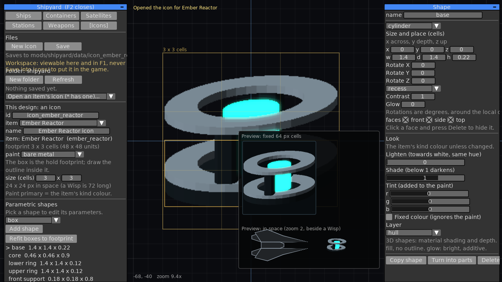

# Parametric icon builder

Open F2 → Icons, then open Steel plates, Iron ore, Deuterium canister, Flit Engine or Ember Reactor to try the examples. Existing polygon artwork remains supported.

Under **Parametric shapes**, choose a shape and click **Add shape**. Select it in the list or on the canvas. Its inspector provides dimensions and position in cells, X/Y/Z rotation in degrees around the part's local origin, material, contrast, glow and color overrides. Ring hole and tapered-cylinder tip ratios remain editable. Copy a shape to build repeated parts; use the existing save-as/item selector to make related item designs. Undo applies to parameter edits.

Shapes: box, beveled block, cylinder, tapered cylinder, hollow ring, wedge and faceted rock. Materials: metal, painted, recess, crystal and emissive. Painted parts inherit icon paint; other presets provide consistent base colors. Shared presets live in `src/icon_model.lua`; local overrides remain in the icon definition.

Solids render with an orthographic depth buffer, not list-order face layering. The editor uses that depth for picking, too. A separate depth-tested emission pass produces a blurred halo, so covered emitters do not shine through solid surfaces. Finished renders are cached; parameter edits rebuild them. Old vector parts can still be drawn beneath or above the model.

The `boxes` list now holds shape parameters as well as legacy boxes. Generated picking faces are omitted from exports; reopening regenerates them. **Turn into parts** is an explicit conversion to ordinary polygon art. **Refit boxes to footprint** recalculates framing; other edits keep the current framing stable.

The editor preview uses 64-pixel cells to judge real inventory readability. This PR does not change the inventory layout or the footprints of existing items. It is a builder trial, with sample art, rather than an inventory redesign.

The existing `love . --test` content check includes a small geometry/export/render check: it renders intersecting solids in reversed list order and requires identical pixels, and round-trips editable parameters through source export. Set `ICON_MODEL_PREVIEW` to an absolute PNG path while running the suite to export a comparison sheet.
