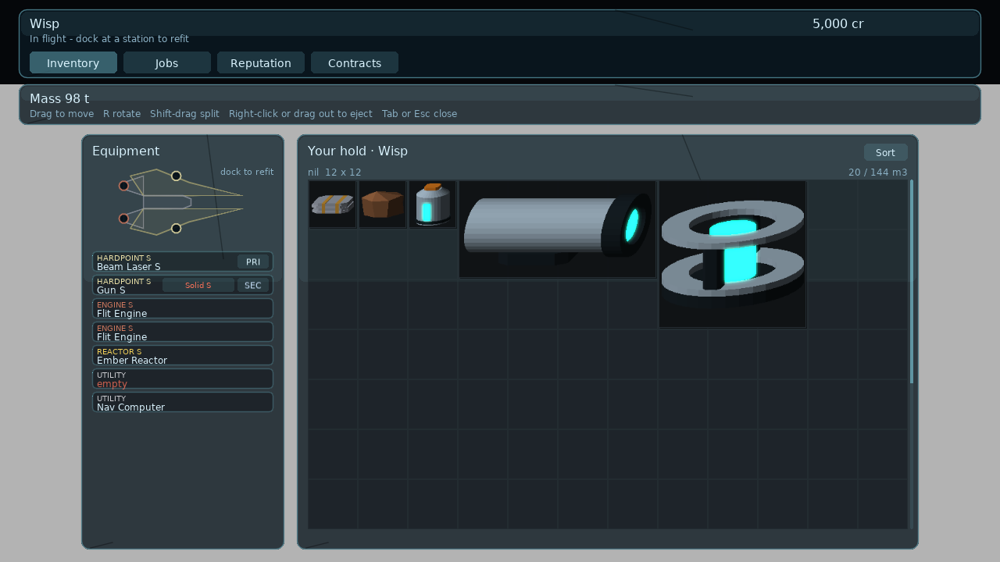

# Parametric icon builder

Open F2 → Icons, then open Steel plates, Iron ore, Deuterium canister, Flit Engine or Ember Reactor to try the examples. Icons use parametric solids only; the legacy icon polygon tools and overlay renderer have been removed. The Icons tab has direct example buttons, and both item selectors include generated module items.

Under **Parametric shapes**, choose a shape and click **Add shape**. Select it in the list or on the canvas. Drag it to move horizontally and vertically (X/Z); adjust depth Y in the inspector. Press N to add the selected shape, Ctrl+D to duplicate, and Delete to remove the selected solid. Its inspector provides dimensions and position in cells, X/Y/Z rotation in degrees around the part's local origin, material, contrast, glow and color overrides. Ring hole and tapered-cylinder tip ratios remain editable. Duplicate a shape to build repeated parts; use the existing save-as/item selector to make related item designs. Undo applies to parameter edits.

Shapes: box, beveled block, cylinder, tapered cylinder, hollow ring, wedge and faceted rock. Materials: metal, painted, recess, crystal and emissive. Painted parts inherit icon paint; other presets provide consistent base colors. Shared presets live in `src/icon_model.lua`; local overrides remain in the icon definition.

Solids render with an orthographic depth buffer, not list-order face layering. The editor uses that depth for picking, too. A separate depth-tested emission pass produces a blurred halo, so covered emitters do not shine through solid surfaces. Finished renders are cached; parameter edits rebuild them. Generated faces are used only for picking and rendering; they cannot be edited as polygons.

The `boxes` list holds editable solid parameters. All built-in icon files have been migrated. Generated picking faces are omitted from exports; reopening regenerates them. **Refit boxes to footprint** recalculates framing; other edits keep the current framing stable.

Both the editor preview and inventory now use fixed 64-pixel cells. Wide inventory workspaces pan instead of shrinking: use Shift + mouse wheel or horizontal wheel input to move sideways. Use Alt + wheel to pan vertically when the overall workspace is too tall; ordinary wheel over a tall grid scrolls its rows. Oversized workspaces show the navigation hint along the bottom. Item footprints are unchanged.

Inventory items now have square, neutral dark backings, quiet borders, hover highlights and backed quantity labels. Trade ownership uses a small colored strip instead of a colored frame.

The existing `love . --test` content check includes a small geometry/export/render check: it renders intersecting solids in reversed list order and requires identical pixels, and round-trips editable parameters through source export. Set `ICON_MODEL_PREVIEW` to an absolute PNG path while running the suite to export a comparison sheet.

