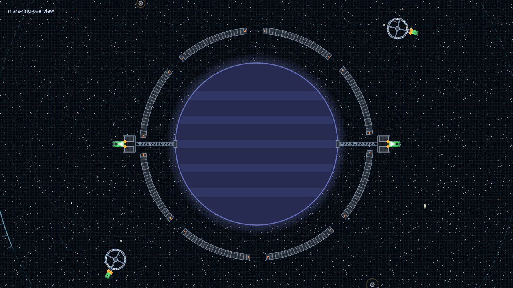
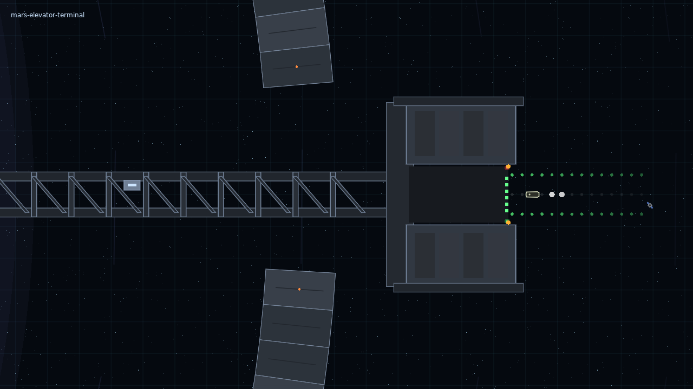
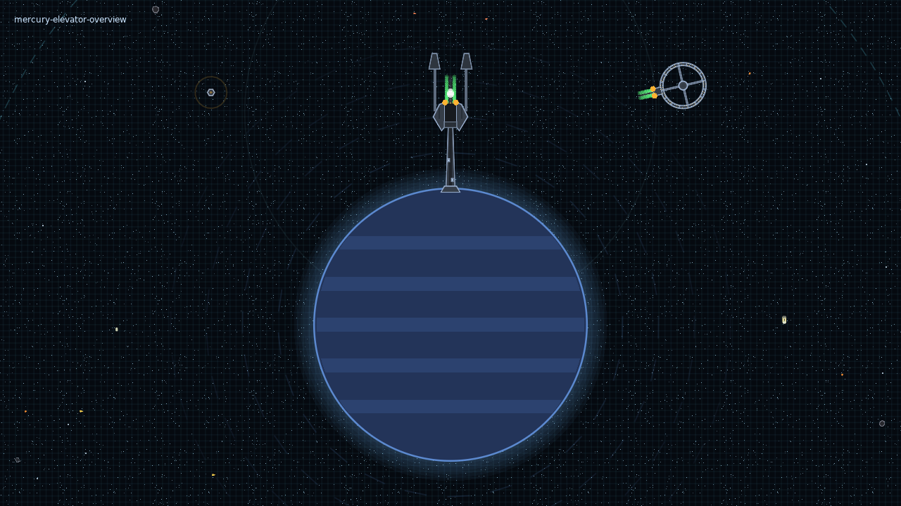
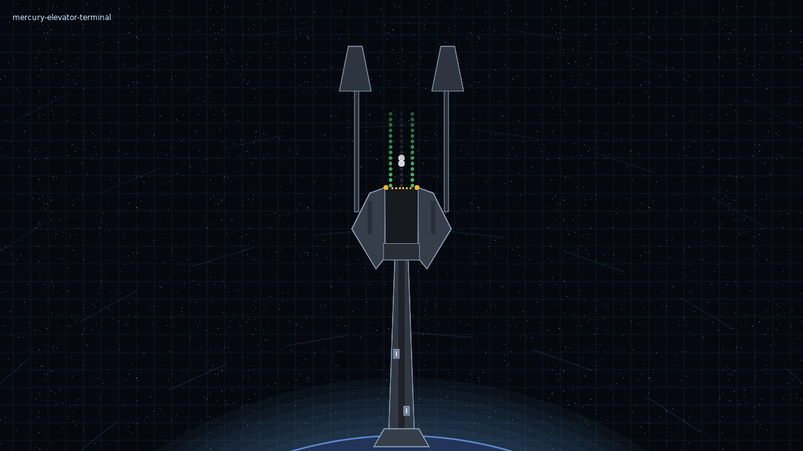

# Orbital infrastructure previews

Captured from the game with `love . --stationtest`. The spinning belt uses its
actual physics rotation; these images show one moment in its motion.

## Mars: Heaven-Ladder

Two fixed, exposed-truss elevators bridge over the thick counter-rotating belt.
Both outward-facing terminals share a single station, hangar, market and storage.

## Mercury: standalone elevator

A separate manufacturer's enclosed spine, swept terminal and forked counterweight.
The counterweight spars flank the open dock approach; there is no orbital ring.

